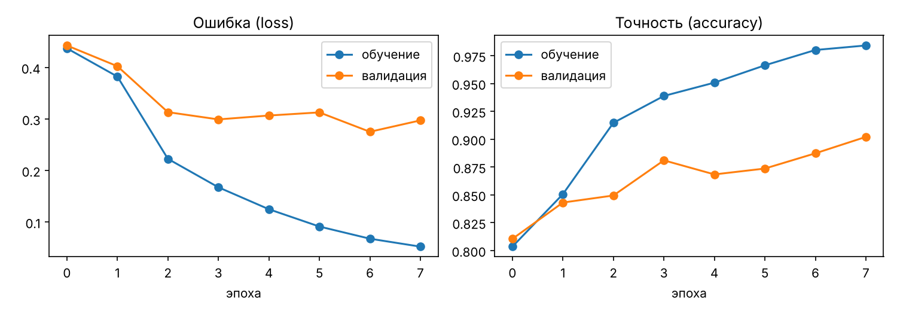
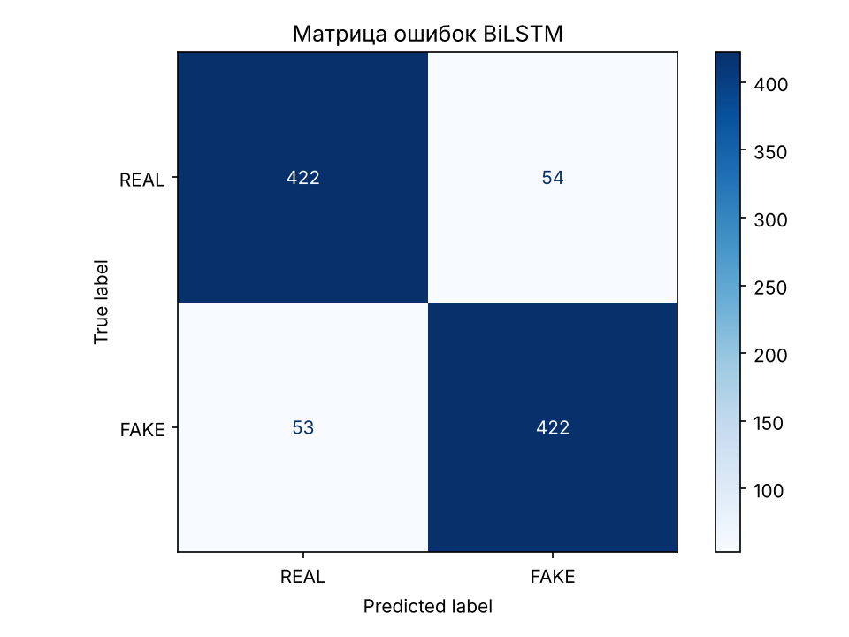

# Терең оқыту әдістері негізінде жалған жаңалықтарды анықтау жүйесі
### Система обнаружения фейковых новостей на основе глубокого обучения (BiLSTM)

Курстық жұмыс, «Терең оқыту» пәні. Орындаған: Жарқымбай Заңғар Берікұлы, ЖИТ-33 тобы.

Курсовая работа по дисциплине «Глубокое обучение». Модель на основе двунаправленной LSTM (BiLSTM) определяет, является ли новость правдивой (REAL) или фейковой (FAKE). Результат сравнивается с классическим базовым методом TF-IDF + логистическая регрессия.

## Датасет
**Fake or Real News**: 6335 англоязычных новостей (`title`, `text`, `label`), около половины фейковых. Загружается автоматически в ноутбуке:
`https://raw.githubusercontent.com/lutzhamel/fake-news/master/data/fake_or_real_news.csv`

Разбиение: 70% обучение, 15% валидация, 15% тест (стратифицированно, `SEED = 42`).

## Методы
1. **Предобработка:** нижний регистр, удаление ссылок и лишних символов.
2. **Baseline:** TF-IDF + логистическая регрессия (scikit-learn).
3. **BiLSTM (PyTorch):** словарь из 20 000 слов, длина последовательности 400, Embedding (128) → BiLSTM → Dropout → Linear + Sigmoid. Функция потерь `BCEWithLogitsLoss`, оптимизатор Adam, сохраняется лучшая по валидации модель.

## Результаты (тестовая выборка)

| Модель | Accuracy | Precision | Recall | F1 |
|---|---|---|---|---|
| TF-IDF + LogReg | 0.9117 | 0.8949 | 0.9326 | 0.9134 |
| BiLSTM | 0.8875 | 0.8866 | 0.8884 | 0.8875 |

Графики обучения, матрицы ошибок и распределение длин текстов лежат в папке [`figures/`](figures/) (файлы `kz_*` с подписями на казахском).




## Запуск
Ноутбук `fake_news_bilstm.ipynb` можно открыть в Google Colab или Jupyter. Нужны: `python3`, `numpy`, `pandas`, `matplotlib`, `torch`, `scikit-learn`.

```bash
pip install numpy pandas matplotlib torch scikit-learn
jupyter notebook fake_news_bilstm.ipynb
```

## Выводы
- Построена система обнаружения фейковых новостей на основе BiLSTM.
- На этом небольшом датасете классическая модель TF-IDF + LogReg немного точнее BiLSTM.
- Ограничения: датасет англоязычный и небольшой, модель учится на стиле текста, а не проверяет факты.
- Развитие: трансформеры (BERT), датасеты на казахском и русском языках, веб-интерфейс.

## Структура
```
fake_news_bilstm.ipynb   ноутбук с кодом и выводами
results.csv              итоговые метрики моделей
figures/                 графики (fig_* и kz_*)
```
